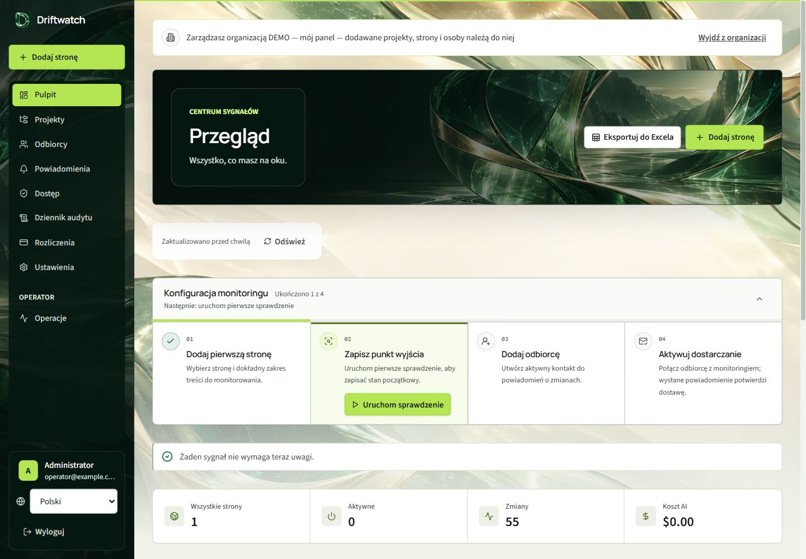

# Driftwatch


Driftwatch is a self-hosted monitor for web page changes. You give it a page
and a CSS selector. It renders the page in Chromium on a schedule, compares the
selected content with the last good snapshot and notifies you by email or
webhook when something changed. An OpenAI model can optionally rate whether a
change matters. Detection does not depend on the model, and the tool runs
without an API key.

It started as an internal tool and is published here as a portfolio project.



More screens are in the [interface gallery](docs/screenshots/README.md). The
screenshots show the Polish interface with synthetic data; English is included.

## How a check works

1. **Capture.** Headless Chromium loads the page, replays any recorded steps
   such as dismissing a banner, and returns the HTML of the selected region.
2. **Normalize.** Scripts, navigation, tracking parameters and the regions you
   chose to ignore are removed.
3. **Compare.** The content is split into records (table rows, list items,
   cards) and compared with the previous snapshot. Swapping two prices between
   rows is a change. Moving whole rows is not.
   [Monitoring semantics](docs/MONITORING_SEMANTICS.md) lists the rules and
   where they stop working.
4. **Record.** The first successful capture becomes the baseline. A failed
   capture never replaces it.
5. **Analyze (optional).** The model receives the diff and the rules you wrote,
   and returns a summary and a verdict: significant or not.
6. **Deliver.** Email (SMTP or Brevo) and webhooks (generic JSON, Slack,
   Discord) go through a transactional outbox with retries per destination.

## Quick start

You need Docker with Compose v2 (Linux containers, x86_64), Python 3.12 or
newer for the setup helper, and about 10 GB of free disk space.

```sh
python scripts/bootstrap_env.py
docker compose up --build -d
```

The helper writes a `.env` with three independent random keys and refuses to
overwrite an existing file. The first build downloads Chromium and the
system packages, so it takes several minutes.

Open http://localhost:8000 and register. The first account on a fresh instance
becomes its administrator. Registration then closes and further users are
invited from the panel. After signing in you are asked to enroll TOTP; then
open **Organizations → Manage** for the default workspace.

For a first monitor, enter a public URL and a CSS selector, choose
**AI disabled** and **Every change**. The first check stores the baseline. The
next content change appears in the history.

Port 8000 is published on loopback only. Read [Deploy](docs/DEPLOY.md) before
putting an instance on a public host. [Install](docs/INSTALL.md) covers running
from source on Windows and Linux, PostgreSQL and upgrades.

### Demo without Docker or API keys

After a source install, one command runs the real pipeline, job queue and
notification outbox against scripted capture, AI and delivery adapters. The
network is blocked and the database is temporary.

```sh
.venv/bin/python -m driftwatch.demo
```

On Windows use `.\.venv\Scripts\python.exe -m driftwatch.demo`. The run goes
through a baseline, ignored noise, a failed analysis, a partial delivery, its
recovery and a change with AI disabled. It exits with an error if any stage
behaves differently. See [Demo](docs/DEMO.md).

## Stack and structure

| Part | Technology |
| --- | --- |
| API and scheduler | Python 3.12, FastAPI, async SQLAlchemy, Alembic, APScheduler |
| Database | SQLite by default, PostgreSQL optional |
| Capture | Playwright with Chromium, in a separate worker container |
| Frontend | React 19, TypeScript, Vite, TanStack Query, Tailwind CSS |
| Checks | pytest, Vitest, Ruff, mypy in strict mode, ESLint, GitHub Actions |

The API process also runs the scheduler. Checks and notifications are queued
in the application database with leases and a bounded number of retries, so
there is no message broker to operate. The browser runs in its own container.
It holds no database, mail, AI or signing credentials, and a firewall sidecar
blocks its connections to private, loopback and metadata addresses.

```text
src/driftwatch/
  api/             HTTP routes, auth dependencies, origin and body guards
  monitoring/      capture, cleaning, record extraction, diff, AI analysis
  notifications/   rendering, email and webhook channels, outbox
  security/        passwords, tokens, TOTP, encryption, URL checks
  billing/         optional Stripe integration, disabled by default
  check_queue.py   durable check jobs: enqueue, lease, retry
  runner.py        one check from capture to delivery
  scheduler.py     periodic enqueue, claims, retention
web/src/           React application
tests/             backend tests
docs/              guides, architecture and decision records
```

## Where to look

- [ADR 001](docs/adr/001-record-diff.md): why changes are detected by comparing
  records with their context instead of raw HTML or a bag of text values.
- [ADR 002](docs/adr/002-db-queue.md): why the job queue lives in the database,
  how leases stop a stale worker from saving results, and what that does not
  guarantee.
- [ADR 003](docs/adr/003-ai-boundary.md): what the model is allowed to decide,
  how each verdict keeps its model, prompt and input hash, and why an unknown
  price is shown as unknown rather than zero.
- [Architecture](docs/ARCHITECTURE.md): process boundaries, tenant isolation,
  sessions, and the browser sandbox.
- [tests/](tests): lease loss and retry exhaustion under a controlled clock,
  tenant isolation, transaction boundaries, and capture with a real browser
  against a local fixture server.
- [CI](.github/workflows/ci.yml): locked dependencies, lint, types and tests on
  Linux and Windows, PostgreSQL integration tests, image scans, and a Docker
  smoke test that checks the firewall at socket level.

## Scope and limits

- Delivery is at least once. If a mail provider accepts a message and the
  process dies before recording it, the message can be sent twice.
- The reference deployment is one Linux host with one API process. The queue
  primitives are tested for concurrent claims, but a multi-replica deployment
  has not been validated.
- Pages behind anti-bot protection, pages that need a login, and unstable
  selectors can fail to capture. A failed capture is reported and never stored
  as a change.
- The comparison works on structure, not meaning. The selector and the ignore
  rules decide what counts as a change. The AI verdict can be wrong.
- The visual selector picker needs a display and is disabled in the Compose
  deployment. Typing a selector works everywhere.
- Browser egress over IPv6 is disabled in the reference firewall.
- Organizations, roles, invitations, TOTP and audited support access are
  included. The Stripe billing module is present but disabled by default, and
  monitoring does not need it.

[Recovery](docs/RECOVERY.md) describes what to do with exhausted jobs and
failed deliveries. [Security](SECURITY.md) lists the trust boundaries.

## Documentation

- [Install and update](docs/INSTALL.md), [Deploy](docs/DEPLOY.md), [FAQ](docs/FAQ.md)
- User guide: [English](docs/USER_GUIDE.en.md), [Polski](docs/USER_GUIDE.pl.md)
- Administrator guide: [English](docs/ADMIN_GUIDE.en.md), [Polski](docs/ADMIN_GUIDE.pl.md)
- [Backup, restore and recovery](docs/RECOVERY.md)
- [Contributing](CONTRIBUTING.md), [Security](SECURITY.md), [documentation index](docs/README.md)

## License

[PolyForm Noncommercial 1.0.0](LICENSE). You can use, modify and redistribute
Driftwatch for noncommercial purposes. Commercial use needs written permission
from the copyright holder; contact the author through
[GitHub](https://github.com/mtpiotrowski1-pixel). This is a source-available
license, not an OSI-approved open-source license.

Dependencies, bundled fonts and system packages keep their own licenses,
listed in [third-party notices](THIRD_PARTY_NOTICES.md). The API
image serves the source it was built from at `/driftwatch-source.tar.gz`.
