# Interface gallery

Screenshots of a local instance with synthetic organizations and data. Capture,
AI and delivery were scripted, so no real provider was involved. The interface
is shown in Polish; an English translation is included. Desktop views are
1440 CSS px wide, mobile views 320 to 375 CSS px. [manifest.json](manifest.json)
records the hash, geometry and source build of each image.

The background artwork and illustrations were made with an AI image generator.
The [brand kit](../../brand-kit/README.pl.md) keeps the source images and the
export scripts.

## Sign in and public landing page

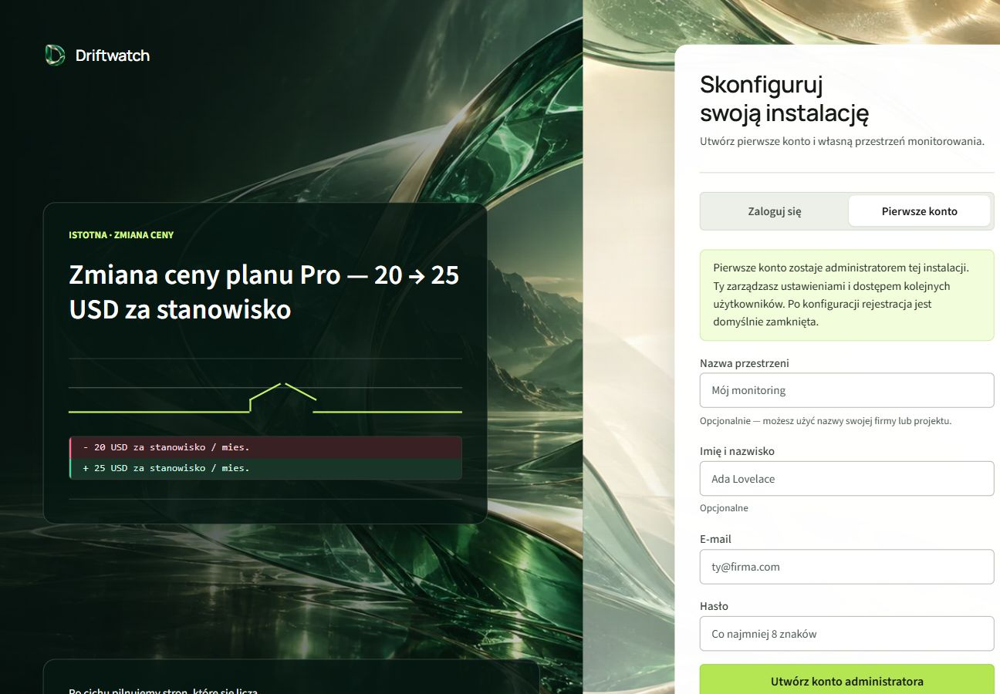

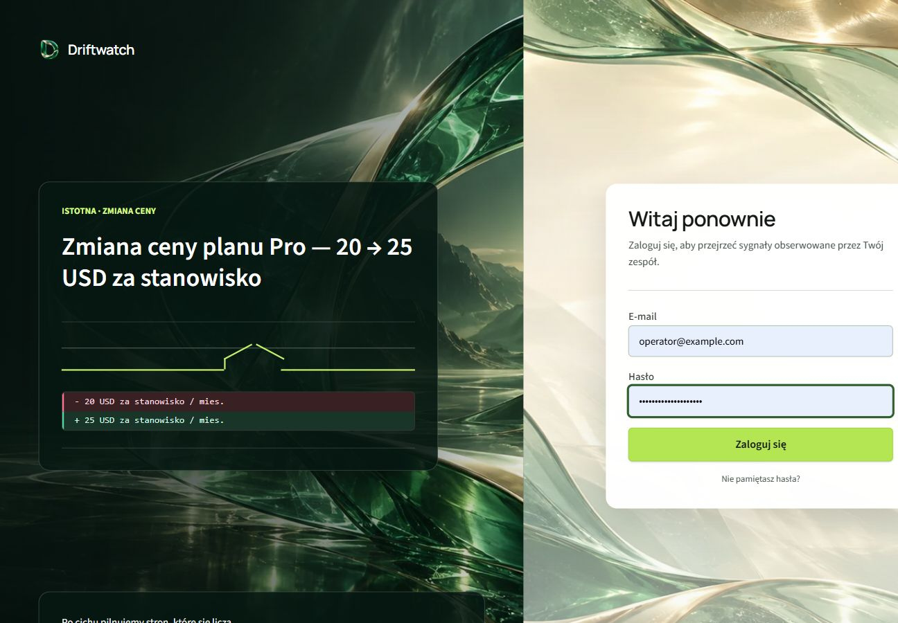

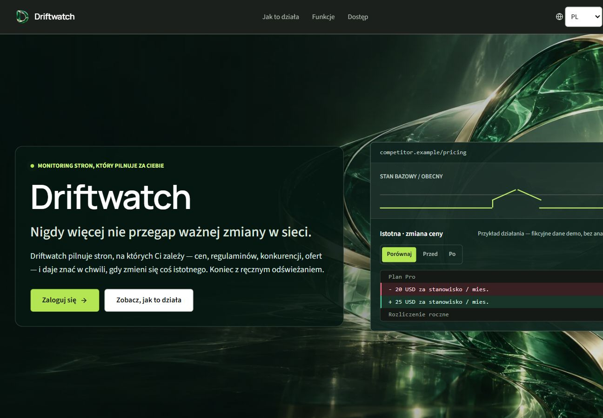

## Monitoring and evidence

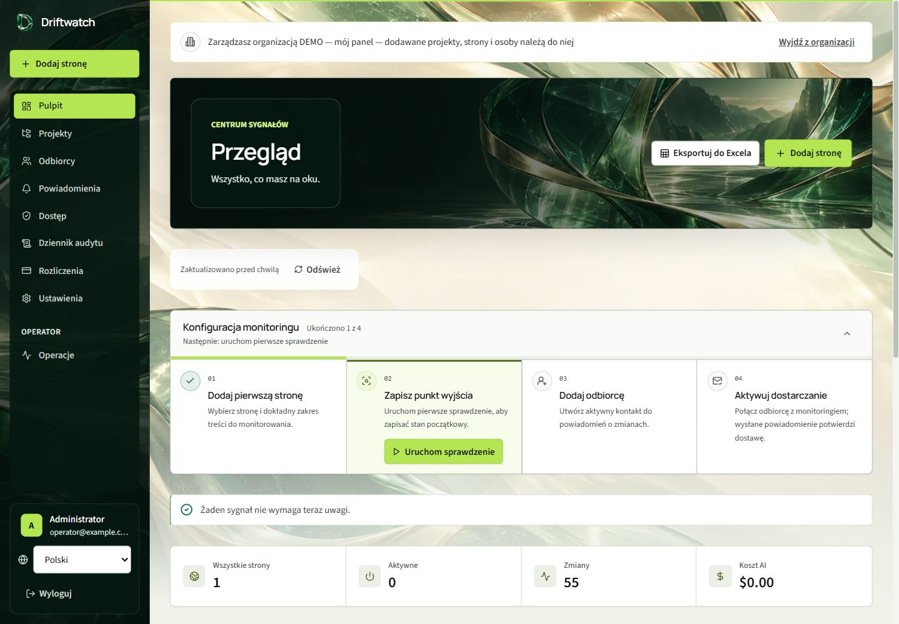

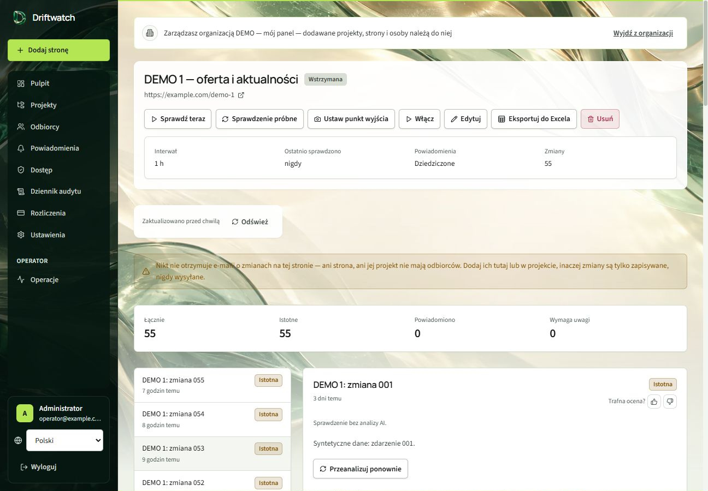

## Responsive views and empty states

| Dashboard | Change history |
|---|---|
| 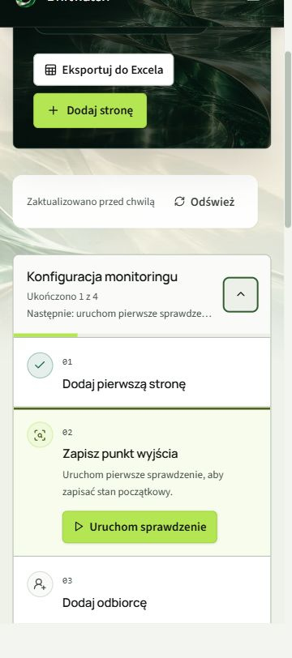 | 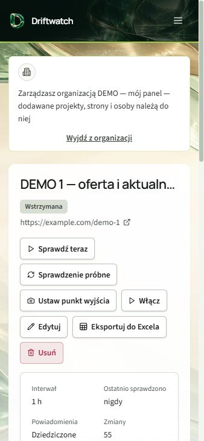 |

| Projects | Recipients |
|---|---|
| 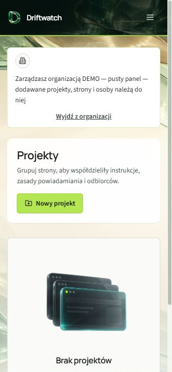 | 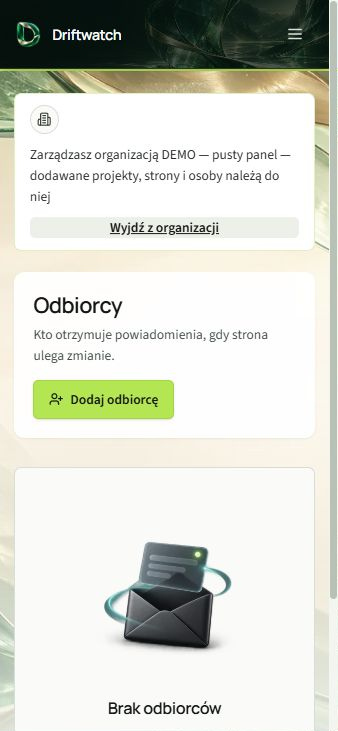 |

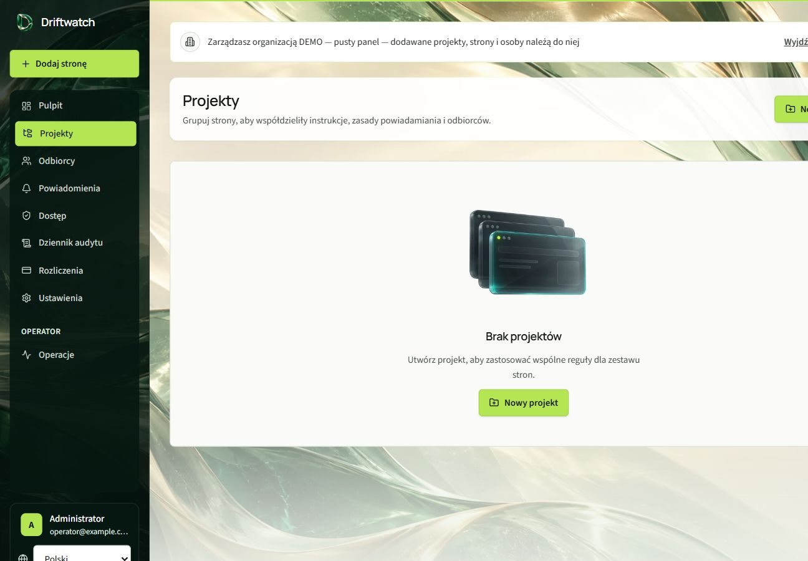

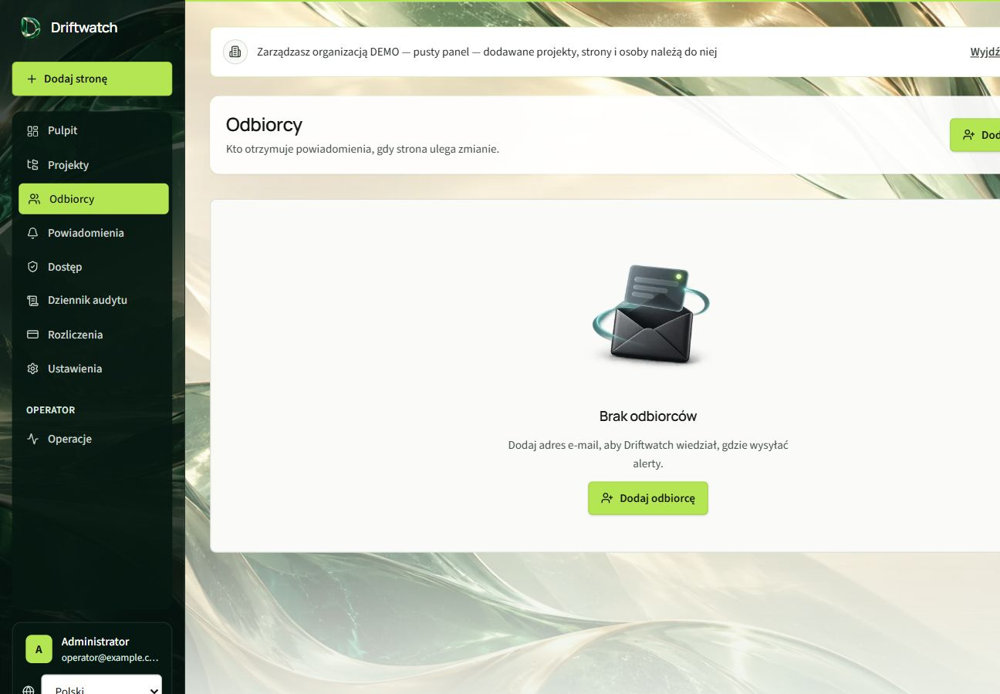

The narrowest supported viewport is 320 px:

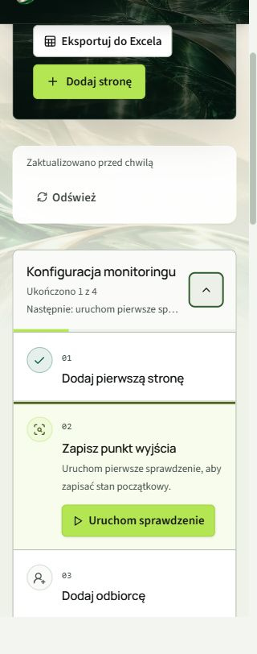

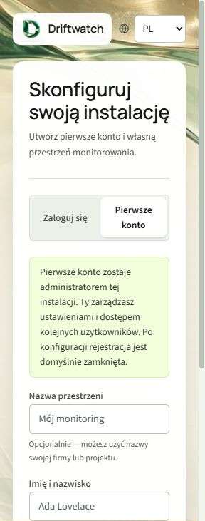

## Access and account recovery

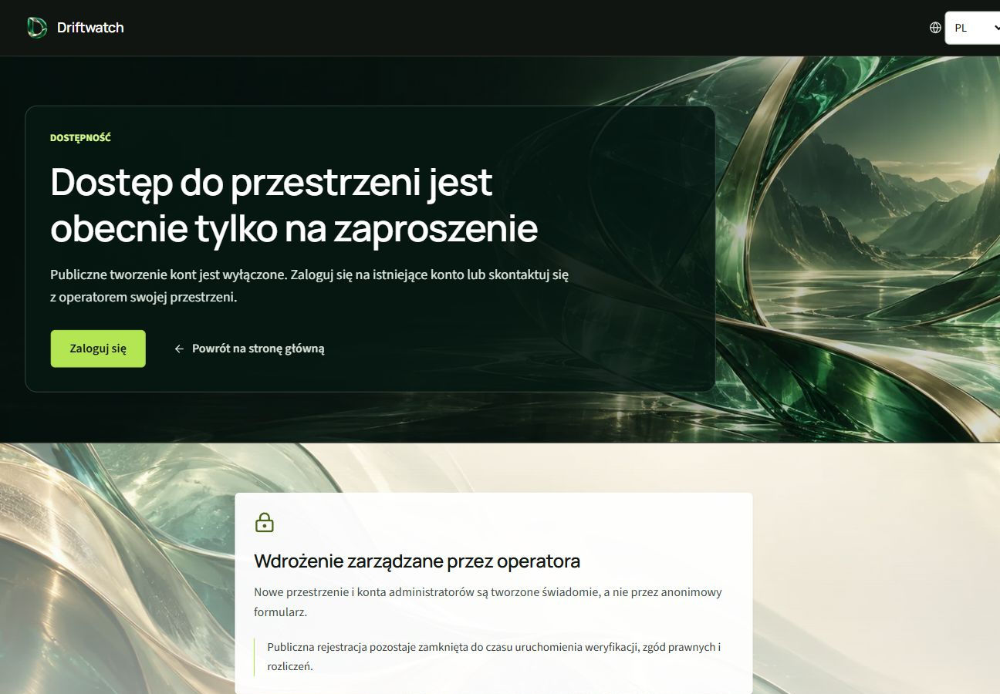

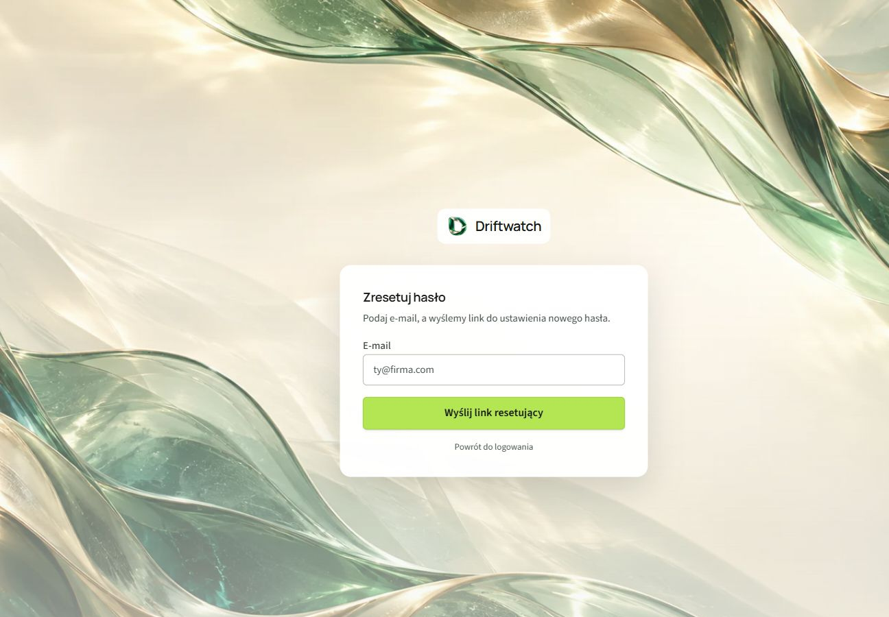
